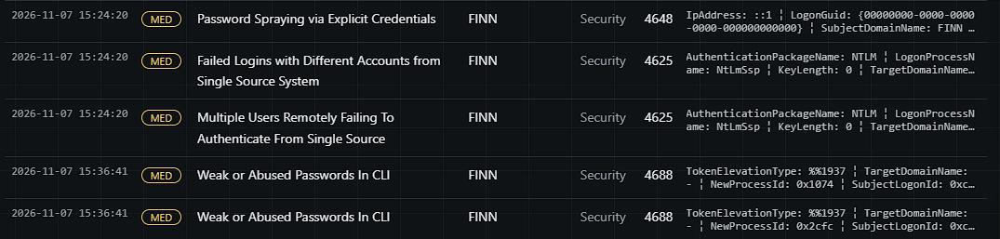
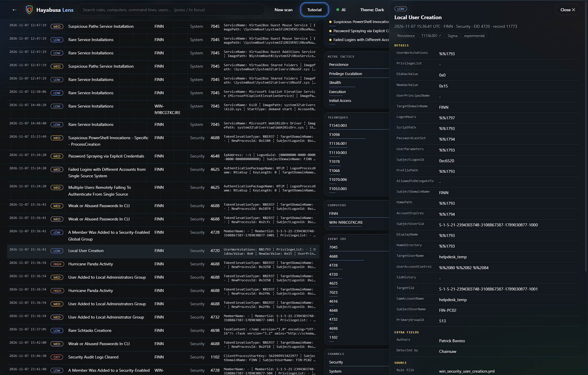
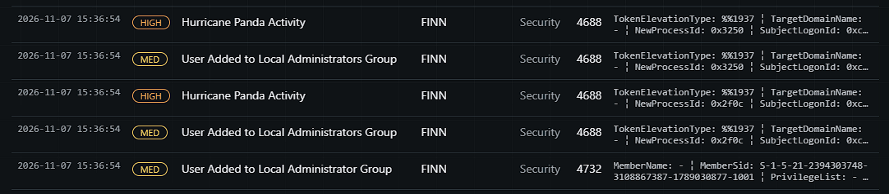
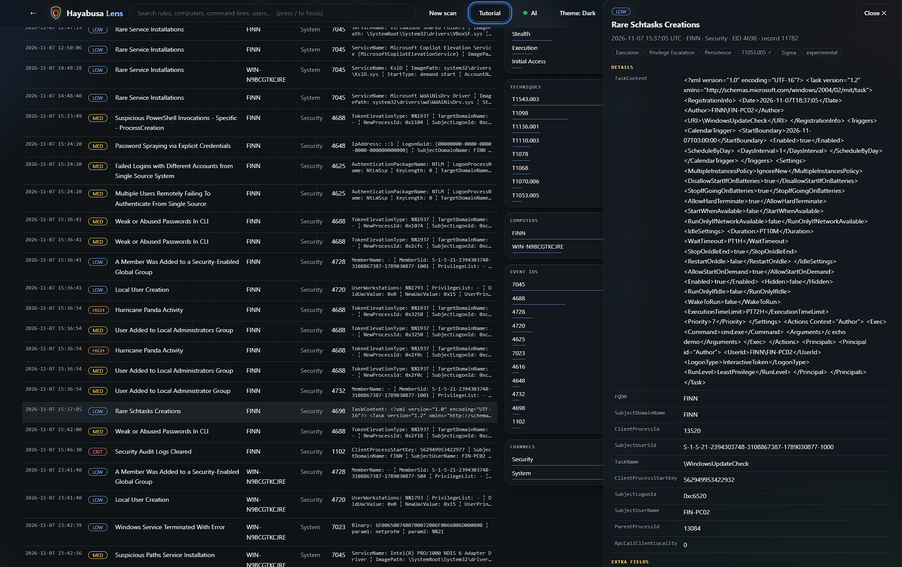
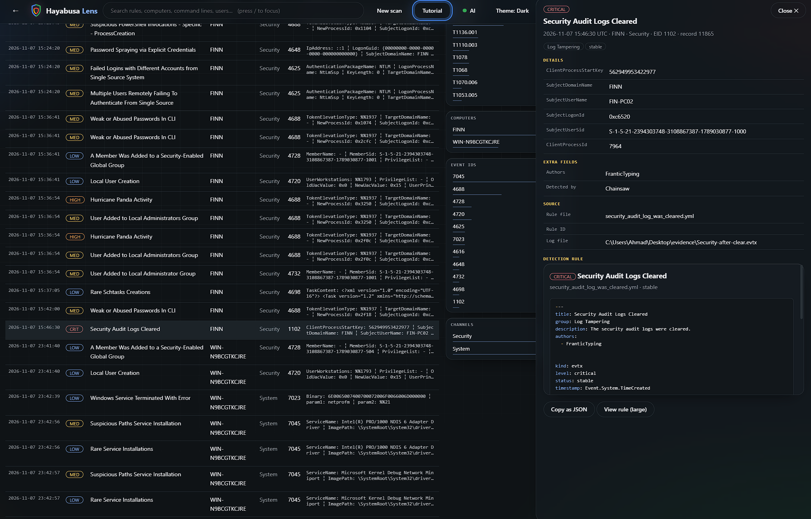

# Investigation Findings

## 1. Incident Overview

A simulated Windows security incident was conducted on a Windows machine named `FINN`.

The scenario involved suspicious authentication attempts, unauthorized account creation, privilege assignment, scheduled task creation, and security log clearing.

The objective was to investigate the generated Windows Event Logs using Hayabusa and Hayabusa-Lens and reconstruct the sequence of activities.

## 2. Initial Access – Password Spraying

**Time:** 2026-11-07 15:24:20 UTC

**Relevant Event IDs:** 4648, 4625

Hayabusa-Lens detected multiple authentication-related alerts, including:

- Password Spraying via Explicit Credentials
- Failed Logins with Different Accounts from Single Source System
- Multiple Users Remotely Failing to Authenticate From Single Source

The events originated from the local machine (`::1`).

These detections indicate suspicious authentication activity consistent with the simulated password spraying attempts.

## 3. Persistence – Local Account Creation

**Time:** 2026-11-07 15:36:41 UTC

**Event ID:** 4720

A new local account named `helpdesk_temp` was created.

The event identifies `FIN-PC02` as the account responsible for creating it.

This account was intended to provide an additional way to access the machine.

## 4. Privilege Escalation – Administrator Group Modification

**Time:** 2026-11-07 15:36:54 UTC

**Event IDs:** 4688, 4732

Process creation evidence revealed the following command:

```cmd
net1 localgroup administrators helpdesk_temp /add
```

This command added `helpdesk_temp` to the local Administrators group, granting it administrative privileges.

The command was executed through the Windows networking utility.

## 5. Persistence – Scheduled Task Creation

**Time:** 2026-11-07 15:37:05 UTC

**Event ID:** 4698

A scheduled task named `WindowsUpdateCheck` was registered.

Configuration details:

- Trigger: Daily at 03:00
- Executable: `cmd.exe`
- Arguments: `/c echo demo`
- Run level: LeastPrivilege
- Hidden: False
- Enabled: True

The task used a name resembling a legitimate Windows update task.

Its configured action was harmless and simply executed `echo demo`.

This demonstrates how scheduled tasks can be used as a persistence mechanism.

## 6. Defense Evasion – Security Audit Log Clearing

**Time:** 2026-11-07 15:46:30 UTC

**Event ID:** 1102

Windows recorded that the Security audit log was cleared.

The event identifies `FIN-PC02` as the responsible account.

The Logon ID was `0xc6520`, matching the earlier suspicious activities.

This provides a correlation between the activities and the same Windows logon session.

## 7. Investigation Conclusion

The investigation reconstructed the following sequence:

1. Password spraying attempts.
2. Creation of a new local account.
3. Addition of the account to the local Administrators group.
4. Creation of a scheduled task.
5. Clearing of Windows Security audit logs.

The newly created account was not used for a confirmed interactive login during the simulation.

The investigation demonstrates how Windows Event Logs can reveal suspicious activity and help reconstruct an attack timeline, even when an attacker attempts to clear audit logs.

## 8. Tools Used

- Hayabusa
- Hayabusa-Lens
- Chainsaw
- Windows Event Viewer
- Windows Security Event Logs


## Evidence Screenshots

### 1. Password Spraying


### 2. Account Creation


### 3. Privilege Escalation


### 4. Scheduled Task Creation


### 5. Security Log Clearing



## MITRE ATT&CK Mapping

The simulated activities were mapped to the MITRE ATT&CK Enterprise framework to categorize the observed behaviors.

| Simulated Activity | Technique | Technique ID |
|---|---|---|
| Password spraying attempts | Password Spraying | T1110.003 |
| Local account creation | Create Account: Local Account | T1136.001 |
| Adding the account to Administrators | Additional Local or Domain Groups | T1098.007 |
| Scheduled task creation | Scheduled Task | T1053.005 |
| Clearing Windows Security logs | Clear Windows Event Logs | T1685.005 |

**Note:** These mappings describe behaviors observed during the controlled simulation. They do not establish that a real threat actor was involved. The scheduled task was configured to execute a harmless demonstration command (`echo demo`), and the newly created account was not used for an interactive login.

For more information, visit the [MITRE ATT&CK Enterprise Matrix](https://attack.mitre.org/matrices/enterprise/).
